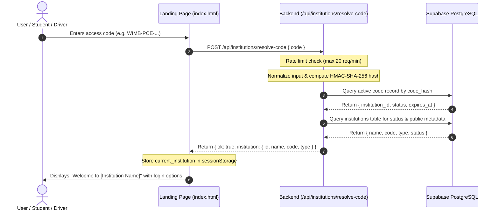

# INSTITUTION ACCESS CODE GUIDE
## Where Is My Bus SaaS Platform

---

## 1. What Is the Institution Access Code?

The **Institution Access Code** is a high-entropy, cryptographically hashed gateway identifier that determines which educational institution a student, teacher, parent, driver, or campus administrator is connecting to.

> [!IMPORTANT]
> **Key Security Distinction:**
> The Institution Access Code **identifies the tenant**; it does **not authenticate the user**. Entering a valid access code does not grant administrator privileges, driver dispatch access, or student access. Every individual must still log in with their individual account (Google SSO, Driver Password, or Admin Credentials).

---

## 2. Access Code Format & Entropy

All access codes follow an unpredictable, standardized alphanumeric format:
```
WIMB-<INSTITUTION_PREFIX>-<BLOCK1>-<BLOCK2>-<BLOCK3>-<BLOCK4>
```

### Examples:
- `WIMB-PCE-7K4M-9Q2W-8R5T-1A3F` (Providence College of Engineering)
- `WIMB-KCT-8F2D-4E1C-9A3B-7C5E` (Kumaraguru College of Technology)
- `WIMB-SJC-3D9A-7B5E-2F1C-8A4D` (St. Joseph's College)

### Cryptographic Security Characteristics:
- Generated with at least **128 bits of true cryptographic randomness** (`crypto.randomBytes(16)`).
- Never uses easily guessed four-digit PINs (e.g., `1234`, `2026`).
- Uniqueness is strictly enforced at the SQL database layer via unique indexes.

---

## 3. Cryptographic Hashing & Zero-Plaintext Rule

Plaintext access codes are **never stored** in the database, backend source files, logs, or browser storage.

When an access code is generated:
1. The plaintext is returned **only once** to the developer or authorized campus administrator.
2. The backend computes an HMAC-SHA-256 digest using a server-side keyed secret (`INSTITUTION_CODE_HMAC_KEY`).
3. Only the 64-character hexadecimal hash is written to PostgreSQL:
   ```sql
   INSERT INTO public.institution_access_codes (institution_id, code_hash, hash_key_version, status)
   VALUES ('e1d4b680-1a2c-4f8a-9e3b-5a7c2d1e0f9b', 'e9d6724c6151c3dea11489a1772c543292c5424081e5b2b9b0898c626fe27f7e', 'v1', 'active');
   ```
4. Even if database tables were exported or leaked, attacker cannot reverse or derive the plaintext access code without the server secret.

---

## 4. Resolution Workflow



---

## 5. Lifecycle Management

### 5.1 Initial Generation
- Performed exclusively by the **Platform Super Admin (Developer)** in the Developer Super Admin Dashboard (`/super-admin.html`).
- The developer copies the code from the One-Time Reveal Modal and securely transmits it to the institution's transit authority.

### 5.2 Access Code Rotation
- **Platform Developer:** Can rotate an institution's code at any time from the Super Admin Console.
- **Institution Administrator:** Can rotate their own code under **Admin Dashboard → Settings → Institution** *only* if the developer has explicitly enabled the `allow_admin_code_rotation` flag for that institution.
- **Immediate Invalidation:** The previous active code status is set to `'revoked'` with timestamp `revoked_at = NOW()`. Any user attempting to use the old code is immediately rejected.
- **Data Integrity:** Code rotation **does not** delete buses, trips, drivers, or students. Existing authenticated sessions remain intact unless explicitly revoked.

### 5.3 Access Code Revocation
- If an access code is compromised, the developer can revoke the code immediately without generating a replacement.
- While revoked, public resolution attempts for that institution fail with:
  `"This access code has been revoked or is inactive."`

---

## 6. Access Code Best Practices for Campus Administrators

1. **Secure Distribution:** Share the code through official institution channels (e.g., student orientation portal, intranet, official campus mobile communication).
2. **Do Not Post Publicly on Billboards:** Treat the code as an internal campus identifier.
3. **Scheduled Rotation:** Rotate the code at the beginning of each academic semester or annual school year.
4. **Emergency Rotation:** If unauthorized individuals obtain access, navigate to **Settings → Institution** and click **Rotate Access Code** to revoke the old code instantly.
